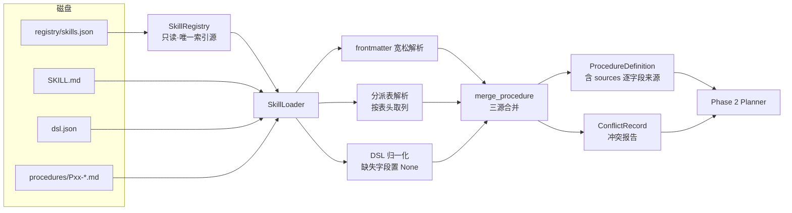
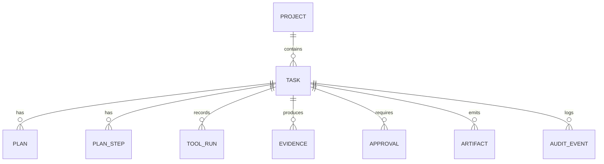

# 运行时架构（as-built · Phase 0–1）

> 本文件只描述**已经存在并能跑**的结构。尚未实现的模块在 §8 明确标注 `NOT_IMPLEMENTED`，
> 不写"计划中当作已完成"。
> 基线：`main` 分支，Phase 0（工程基础）+ Phase 1（Skill Runtime）已完成，测试 127 项全绿。

---

## 1. 分层与依赖方向

```
┌─────────────────────────────────────────────────────────────┐
│ Interface（NOT_IMPLEMENTED）  cli/ · api/ · adapters/mcp/    │
└───────────────────────────┬─────────────────────────────────┘
                            │ 只允许调用 Application
┌───────────────────────────▼─────────────────────────────────┐
│ Application（NOT_IMPLEMENTED）  TaskApplicationService        │
└───────────────────────────┬─────────────────────────────────┘
                            │
┌───────────────────────────▼─────────────────────────────────┐
│ Runtime（Phase 1 ✅）  agent/skills/                          │
│   Registry ── Loader ── Parser ── Router                     │
└───────────────────────────┬─────────────────────────────────┘
                            │ 只读消费
┌───────────────────────────▼─────────────────────────────────┐
│ Content  skills/  registry/skills.json（仓库既有资产，不写）  │
└─────────────────────────────────────────────────────────────┘

横切：agent/models（Pydantic）· agent/storage（SQLite）· agent/security（隔离/脱敏）
```

**依赖方向铁律**：`models` 不依赖任何业务模块；`security` 不依赖 `skills`／`storage`；
`skills` 只读文件系统，不写。任何反向依赖都会让"技能层可被任意 agent 使用"这条约束失效。

---

## 2. 已实现模块清单

| 模块 | 文件 | 职责 | 状态 |
| --- | --- | --- | --- |
| 数据模型 | `agent/models/*.py`（9 个） | Task/Plan/Procedure/Evidence/Approval/ToolResult + 8 个枚举 | ✅ |
| 数据库 | `agent/storage/orm.py` `database.py` | 9 张表、外键、索引、WAL、乐观锁 | ✅ |
| 工作区隔离 | `agent/security/workspace.py` | 路径穿越防护、原始资料只读+哈希、副本先行 | ✅ |
| 权限 | `agent/security/permissions.py` | 工具白名单、调用预算、网络/Shell 默认禁止 | ✅ |
| 审计日志 | `agent/security/audit_log.py` | JSONL + trace_id + PII 脱敏 | ✅ |
| 配置 | `agent/config/settings.py` | `AUDITOX_*` 环境变量，路径单一真相 | ✅ |
| 技能注册表 | `agent/skills/registry.py` | 只读 `registry/skills.json`，检索、路径校验 | ✅ |
| 技能加载器 | `agent/skills/loader.py` | SKILL.md / dsl / 程序卡 / 模板 / 底稿制式 | ✅ |
| DSL 与分派表解析 | `agent/skills/parser.py` | 按表头取列、三源合并、冲突记录 | ✅ |
| 技能路由 | `agent/skills/router.py` | 别名+科目号+索引三级，含糊即问人 | ✅ |
| Planner / Executor / Tools / Quality / Writer / CLI / API / MCP | — | — | ❌ Phase 2–7 |

---

## 3. 技能解析数据流（Phase 1 核心）



### 三源合并规则（关键设计）

| 字段 | 来源优先级 | 说明 |
| --- | --- | --- |
| `id` / `tools` | `dsl.json` | 唯一权威 |
| `name` | dsl → SKILL.md | 差异记 INFO |
| `assertions` | `SKILL.md` 分派表「对应认定」 | DSL 里没有此字段 |
| `workpaper_index` | `SKILL.md` 分派表「产出底稿」 | 用正则从自由文本提取，提不出返回 `None` |
| `mandatory` | 程序名含「强制」 | `P05 银行函证程序（强制）` |
| `conditional` / `condition` | SKILL.md 正文限定句式 | 只认「P09 视…决定是否启用」形态 |
| `dependencies` | **运行时配置**（Phase 2） | DSL 无此字段，技能层返回空，不编造 |
| `execution_policy` | **三源取最严** | 见下 |

**执行策略取值（PART 11.3 保守策略）**：

```
human_confirmation = dsl.human(True) ∨ 「执行方式」含"人工" ∨ 程序卡含【人工】
human_judgment     = 「执行方式」含"判断/评价" ∨ 含"人工为主"
mode               = HUMAN_LED > AUTO_WITH_JUDGMENT > AUTO_WITH_CONFIRM > AUTO
```

只要任一来源要求人工，结果就要人工，**不允许用 DSL 的 `human:false` 把人工要求降下去**。

---

## 4. 数据模型

### 4.1 核心模型关系



### 4.2 证据链约束（代码强制）

`Evidence.traceable` 为 `True` 的必要条件：

1. 有源文件 **且** 有源文件 sha256；
2. 有结果文件 **或** 有内联结果引用。

缺任一条即 `traceable=False`，质量门（Phase 5）将据此拒绝关闭程序。

### 4.3 状态机取值

任务 10 态：`CREATED → PLANNING → WAITING_INPUT → READY → RUNNING → WAITING_HUMAN → VERIFYING → COMPLETED`，另有 `FAILED` / `CANCELLED`。

步骤 10 态，其中人工程序必须走完三段：
`WAITING_HUMAN → HUMAN_COMPLETED（人交了材料）→ VERIFIED（材料过质量门）`。
**`HUMAN_COMPLETED` 不等于关闭程序**，这是 PART 12 的硬要求。

---

## 5. 安全机制

| 风险 | 措施 | 位置 |
| --- | --- | --- |
| 路径穿越 | 所有路径经 `resolve_inside()`，符号链接与 `..` 归一化后断言仍在根内 | `workspace.py` |
| 原始资料被改 | 复制进工作区 + `chmod` 去写位 + sha256 登记，可事后比对 | `workspace.py` |
| 写坏底稿 | `resolve_for_write()` 拒绝写原始资料目录；`backup()` 副本先行 | `workspace.py` |
| 工具越权 | 白名单 + 调用预算 + 风险分级；`DESTRUCTIVE` 一律拒绝 | `permissions.py` |
| 外部网络 | `allow_network` 默认 False，且第一版无开启入口 | `settings.py` + `permissions.py` |
| Shell | `ShellGuard` 恒拒绝，不做命令白名单解析 | `permissions.py` |
| 敏感信息入日志 | 账号/身份证/手机/邮箱模式化脱敏 + 敏感键整体替换 | `audit_log.py` |
| 密钥硬编码 | 只从 `AUDITOX_LLM_API_KEY` 读，`repr` 与日志不输出 | `settings.py` |

---

## 6. 可观测性（Phase 0 已有部分）

| 能力 | 现状 |
| --- | --- |
| 结构化日志 | ✅ JSON Lines，一行一事件，立即 flush |
| trace_id | ✅ 每条记录携带，可跨工具调用串联 |
| 状态变更留痕 | ✅ `audit_events` 表含 `from_status`/`to_status`/`actor` |
| 工具调用记录 | ✅ `tool_runs` 表（字段就位，Phase 3 起写入） |
| 指标（P95/成本/失败率） | ❌ Phase 4 |

---

## 7. 与技能库的边界

- 运行时**只读** `skills/` 与 `registry/skills.json`；
- 不新增、不改写任何 `SKILL.md` / `dsl.json` / 程序卡；
- `tools/build_index.py`、`tools/validate_skills.py` **零改动**（CI 依赖它们零依赖运行）；
- 技能库脱离运行时仍可被任意 agent 直接读取（本次改动未触碰该性质）。

---

## 8. 未实现清单（NOT_IMPLEMENTED）

| 模块 | 原因 | 计划阶段 |
| --- | --- | --- |
| `agent/core/planner.py` | 依赖本阶段产出的 `ProcedureDefinition`，下一步实现 | Phase 2 |
| `agent/config/procedures/bank_deposits.yaml` | 需先定 DAG Schema 与校验器 | Phase 2 |
| `agent/tools/*`（11 个确定性工具） | 技能库只有工具名契约，实现需逐个定 Schema | Phase 3 |
| `agent/core/executor.py` `orchestrator.py` | 依赖工具层 | Phase 4 |
| `agent/quality/*` | 依赖证据与工具产物 | Phase 5 |
| Workpaper Writer | 依赖模板填充与公式校验方案 | Phase 5 |
| `cli/` `api/` `adapters/mcp/` | 接口层最后接 | Phase 6–7 |
| LLM 适配器 | 第一版可全程确定性跑通，LLM 仅辅助 | Phase 2 起按需 |

---

## 9. 已知技术限制

1. **Excel 公式不求值**：`openpyxl` 只写公式文本，不计算。底稿勾稽需 Python 侧独立复算后交叉校验。
2. **模板双版本**：银行存款包有 `模板.xlsx`（8 表）与 `模板_v1.1.xlsx`（10 表），Phase 5 固定使用 v1.1 并在底稿元数据记录版本号。
3. **`registry/skills.json` 为生成物**：`refresh(write=False)` 默认只校验不写盘，避免时间戳造成无意义 diff。
4. **程序卡缺口 11 份**（`f-6-payroll-payable` 7、`z-1-3` 2、`auditox-wp-standard` 2）：加载器如实上报 `missing_procedure_docs`，不补写内容。
